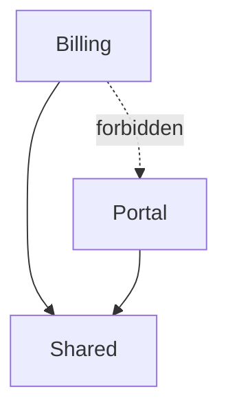
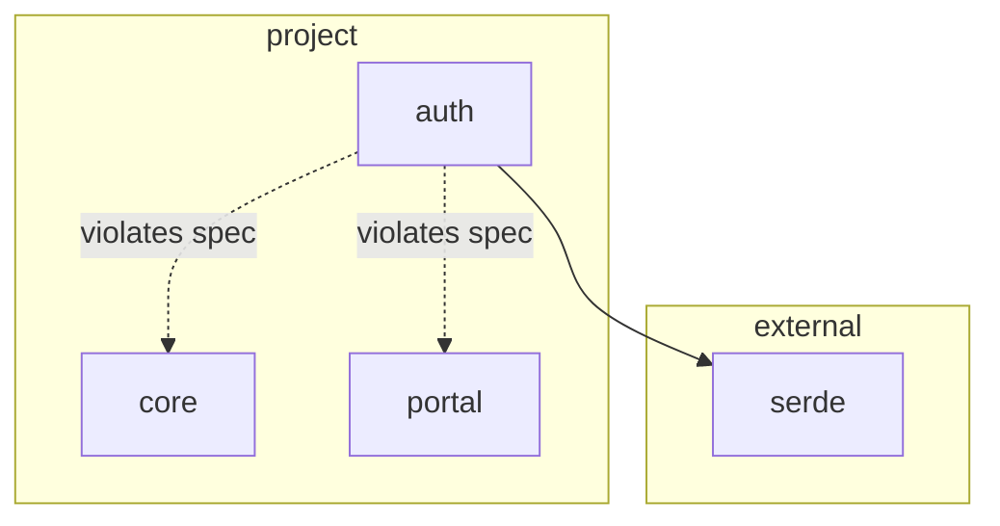
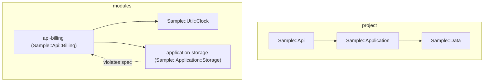

# `diagram` — Output Contract

## Destination

- Default: diagram written to **stdout**, exit code `0`.
- `--output <path>`: diagram written to the file, **stdout stays empty**, exit code `0`. `--output -` prints the diagram on stdout and creates no file.

## Formats

| Flag | Format | Notes |
|---|---|---|
| `--format mermaid` (default) | Mermaid flowchart | `graph TD`, component clusters |
| `--format plantuml` | PlantUML | component packages |

Both formats are deterministic text (ADR-013) — no SVG, no images.

## Diagram structure

The diagram always contains:

1. **One node per component** (declared spec) or **one node per unit** (scan snapshot). Node label is the component or unit name. On a scan snapshot with `--tiers modules`, the render adds **one node per resolved module endpoint** inside a `modules` wrapper cluster: an endpoint owned by a governing-spec claim renders under the owning claim name with a dual label (`api-billing["api-billing (Sample::Api::Billing)"]`); an unowned endpoint keeps the module path as id base and label. Without `--tiers` the module tier draws nothing and the bytes are exactly the unit render's.
2. **One edge per dependency** between them. Edge direction: depending component/unit → depended-upon. Module edges collapse to one arrow per distinct resolved endpoint pair — duplicates and symbol multiplicity draw nothing, and an edge whose endpoints resolve to one node draws nothing.
3. **External crates in a separate cluster** (scan mode): dependencies to external crates are grouped into a visually distinct cluster, separated from the project's own nodes. In spec mode there are no external crates — the declared model contains no extracted dependencies. External crates stay driven by the unit tier; the module tier is first-party namespace structure.
4. **Violating/forbidden edges marked**: dashed red arrows. In spec mode these are the dependencies the spec declares forbidden. In scan mode an edge is marked exactly when `verify` reports its pair — a `forbidden edge` or a `disallowed cross-component dependency`, at the unit tier or (under `--tiers modules`) at the module tier. The mark reads `verify`'s verdict through the same adjudication, never a diagram-side re-derivation.
5. **Role markers on role-addressed nodes (scan mode only)**: a node is marked iff the model's `roles` map holds a key equal to that node's name under the `.`/`::` separator equivalence (the key `Shop::Api` marks the node `Shop.Api`) — exact identity, no fold and no subtree containment. Mermaid carries the marker as a quoted-label suffix (`Shop_Api_9243f63f["Shop.Api [composition]"]`), PlantUML carries it as a stereotype on the declaration (`component Shop.Api <<composition>>`) while edge lines stay raw; node ids and every other node line keep their exact unmarked bytes, and the external cluster — addressed by no roles key — never marks.

Marked edges are the picture's "danger" signal: edges the architecture forbids, either because they are declared banned (spec mode) or because the code has drifted from the declaration (scan mode with a spec present) — in scan mode a dash is the picture form of a `verify` finding, so the dashed edge's endpoint names grep to the finding. When nothing binds an edge, it renders solid.

Role marks exist in scan mode only: spec mode's nodes are declared components rather than model paths, so `diagram` in its default mode reads no roles map and its bytes never move. A role marker addresses unit-tier nodes only — a `modules`-cluster node carries none in either flag state. A role keyed below the unit tier — the rust bin composition key `tool::main` — addresses no node of the diagram's unit vocabulary and marks nothing here while `inspect tree` marks the same entry one tier down (see `../inspect/output.md`).

## Determinism

The same input always produces **byte-identical output**. Node and edge ordering is canonical (nodes by name, edges by from-then-to), independent of any traversal order. Output is safe to commit to version control (see `flows.md`).

Mermaid node ids are collision-proof by construction: names made only of `[A-Za-z0-9_]` keep their bare readable id, while names that need character substitution (`.`, `::`, `/`, `-`, …) carry an 8-hex stability suffix derived from the raw name, so distinct raw names never share an id. Module-tier ids salt the raw name with its tier before the same construction, so a claim named exactly like a unit still renders two distinct nodes.

## Example

Declared spec (abbreviated, `../../spec.md`):

```
modules: Billing, Shared, Portal
dependencies: Billing -> Shared, Portal -> Shared
forbidden:   Billing -> Portal
```

Mermaid output (representative):



Node labels are component names; the forbidden edge is dashed. Nested sub-components render as nodes inside their parent component's cluster.

Scan output for a project whose extracted model contains units `auth`, `core`, `portal`, depends on external crate `serde`, and whose governing spec claims all three units with `auth` forbidding `portal` and carrying an `allowed` table whose `depend_on` ceiling omits `core` (representative):



Node labels are unit names; external crates are grouped in their own cluster; both dashed edges are the picture of findings `verify` reports — `auth -> portal` as a `forbidden edge`, `auth -> core` as a `disallowed cross-component dependency` the old solid render used to disagree with. This snapshot states no roles, so no node carries item 5's marker — add `"roles": { "auth": "composition" }` to the artefact and the `auth` label renders as `auth["auth [composition]"]` while every other line keeps its bytes.

The same snapshot rendered with `--tiers modules`, under a governing spec whose claims own the module endpoints (abbreviated module edges: `Sample::Api::Billing` → `Sample::Application::Storage` both ways, the reverse pair forbidden by the `application-storage` claim, plus `api-billing` → the unowned `Sample::Util::Clock`):



Every line outside the `modules` cluster keeps its exact byte-for-byte shape from the default render — the module tier is additive. Owned nodes carry claim-name identity with the path in the label; the unowned endpoint keeps its path; the forbidden module pair dashes exactly as `verify`'s `forbidden edge` finding reads.
